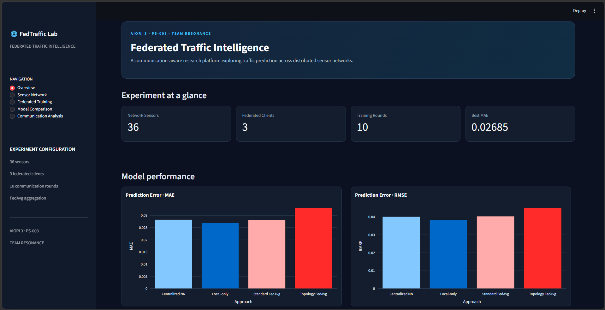
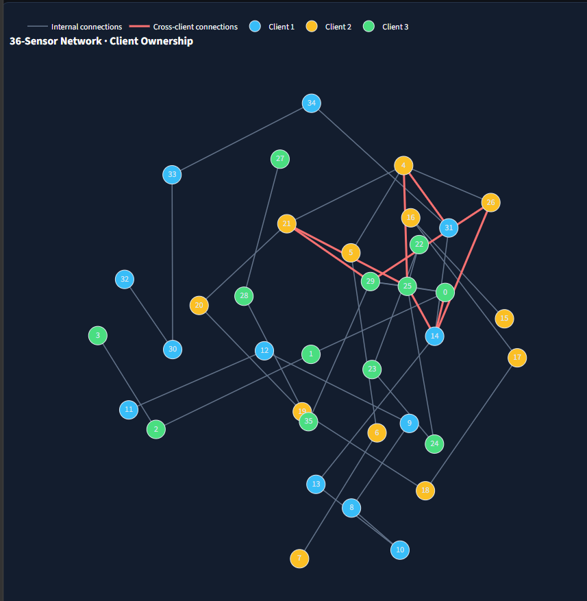
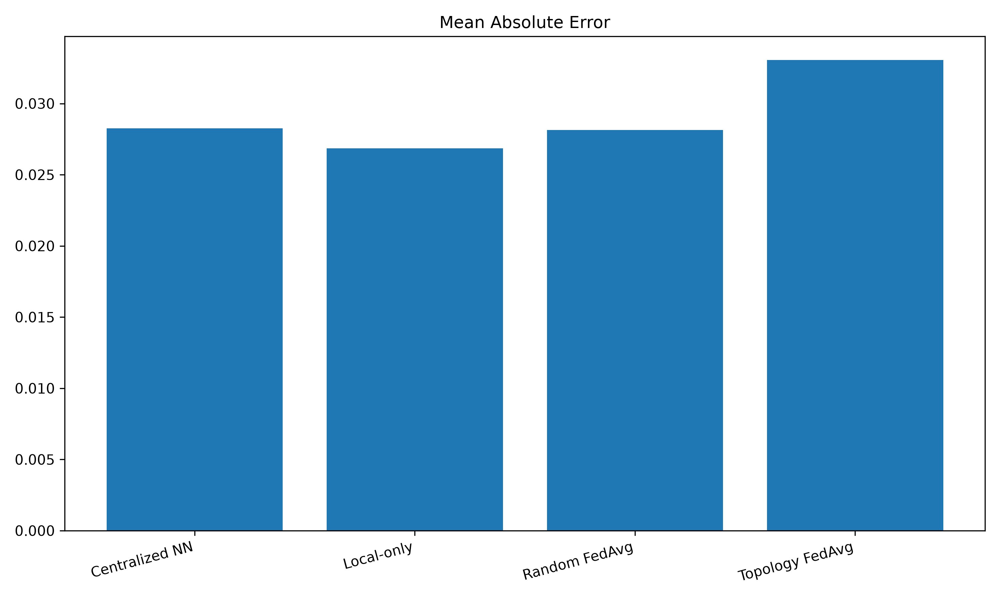
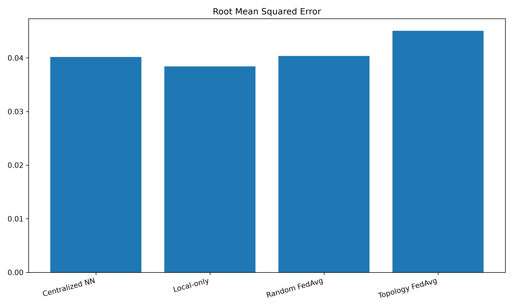
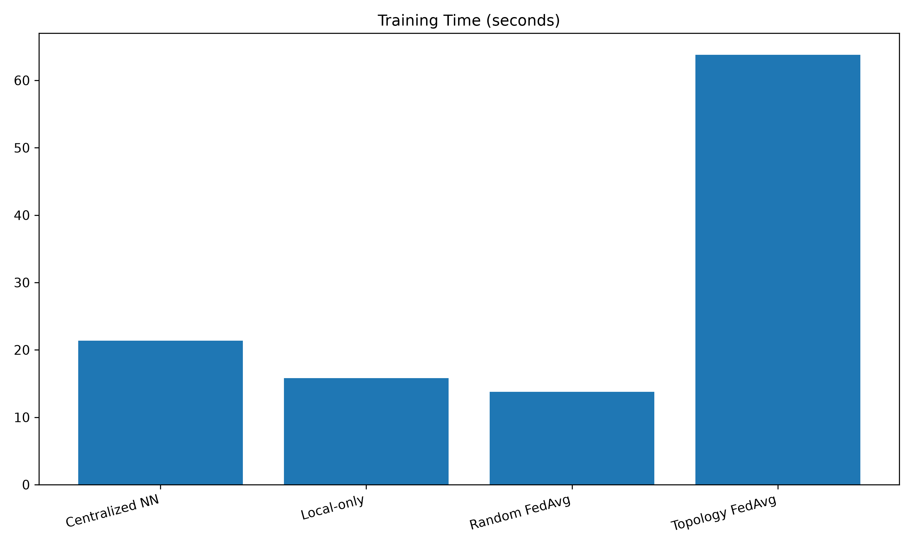
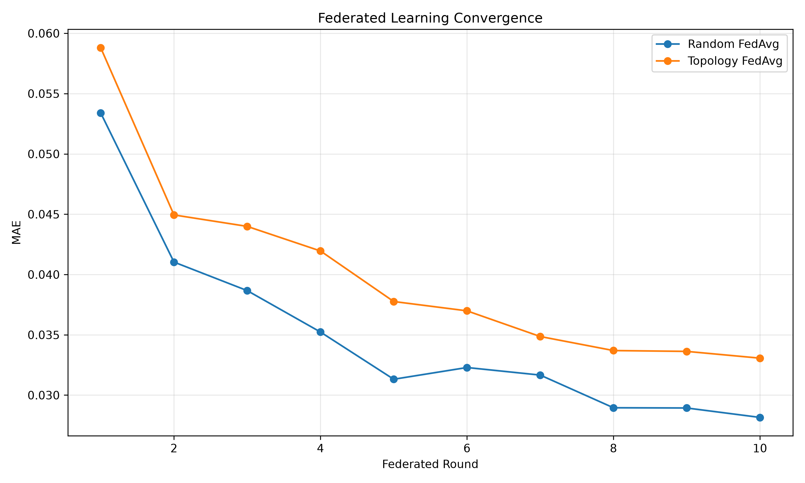
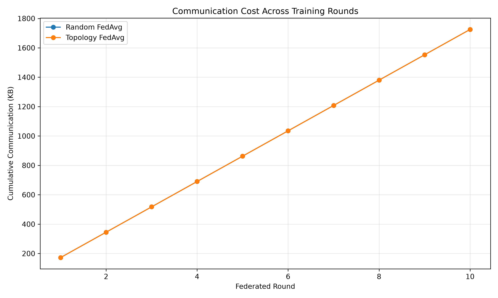

# 🌐 RESONANCE — Federated Traffic Intelligence

### AIORI 3 Hackathon | PS-003 — Federated Traffic-Flow Prediction with Communication-Cost Evaluation

**Team:** RESONANCE  
**Repository:** [A3-PS003-TC141](https://github.com/aiori-hackathon/A3-PS003-TC141)

---

## 🚦 Project Overview

**Federated Traffic Intelligence** is a communication-aware research platform that explores traffic-flow prediction across distributed sensor networks.

The project investigates how different learning approaches perform when traffic sensors are distributed among multiple clients. It compares centralized learning, independent local learning, standard Federated Averaging (FedAvg), and topology-aware federated learning.

The platform evaluates these approaches using prediction accuracy, training time, and estimated model communication costs.

Our objective is to study the trade-offs between prediction performance, distributed training, and communication overhead.

## 🎯 Problem Statement

**PS-003: Federated Traffic-Flow Prediction with Communication-Cost Evaluation**

Traditional centralized traffic prediction approaches require data to be collected and processed at a central location. In distributed sensor networks, this can create communication and scalability challenges.

Federated learning offers an alternative by allowing multiple clients to train local models and share model updates instead of directly sharing their training data.

However, how sensors are assigned to clients can influence model performance and communication requirements.

This project investigates these differences through experimental comparisons.

## 🧠 Proposed Approach

We implemented and evaluated four learning approaches:

| Approach | Description |
|---|---|
| Centralized Neural Network | Trains one model using data from all sensors. |
| Local-only Learning | Trains independent models without exchanging model updates. |
| Standard FedAvg | Uses multiple clients and aggregates their model updates using Federated Averaging. |
| Topology-aware FedAvg | Uses sensor-network connectivity to create client groups before federated training. |

### Topology-aware Client Partitioning

The traffic network contains 36 sensors connected through an adjacency matrix.

A topology-aware partitioning strategy groups connected sensors into three clients, aiming to preserve more internal network connections within each client.

The resulting partition contains:
- 36 traffic sensors.
- 3 federated clients.
- 12 sensors per client.
- 43 undirected network connections.
- 35 internal connections within client groups.
- 8 connections crossing client boundaries.

**Important:** Network topology is used for client assignment. The prediction model is an MLP neural network, not a Graph Neural Network (GNN).

## 🏗️ System Configuration

| Parameter | Configuration |
|---|---|
| Dataset sensors | 36 |
| Input features | 48 |
| Prediction horizon | 15 minutes |
| Federated clients | 3 |
| Communication rounds | 10 |
| Local epochs per round | 2 |
| Neural network | Multilayer Perceptron (MLP) |
| Optimizer | Adam |
| Learning rate | 0.001 |
| Loss function | Mean Squared Error (MSE) |
| Aggregation | Federated Averaging |
| Evaluation metrics | MAE and RMSE |

## 📊 Interactive Dashboard

The Streamlit dashboard provides an interactive view of the experiments, sensor network, federated training process, model performance, and communication analysis.

### Dashboard Overview



### Sensor Network Topology

The network visualization represents the 36 sensors and their client assignments. Different colors identify the three federated clients, while edge colors distinguish internal and cross-client connections.



### Model Performance Comparison

The following plots compare the prediction performance and observed training time across the four approaches.

**Mean Absolute Error (MAE)**



**Root Mean Squared Error (RMSE)**



**Training Time**



### Federated Learning Convergence

The convergence plot illustrates the change in prediction error across federated communication rounds.



### Communication Cost Analysis

This visualization compares estimated model-payload communication across the federated approaches.



## 📈 Experimental Results

The following results are from the implemented experiments.

| Approach | MAE | RMSE | Training Time (s) |
|---|---:|---:|---:|
| Centralized NN | 0.028250 | 0.040177 | 21.38 |
| Local-only | 0.026849 | 0.038428 | 15.81 |
| Standard FedAvg | 0.028151 | 0.040374 | 13.79 |
| Topology-aware FedAvg | 0.033065 | 0.045063 | 63.81 |

*Training times are observed execution times from the recorded runs and are not controlled hardware benchmarks.*

### Key Observations

- Local-only learning achieved the lowest MAE and RMSE among the evaluated approaches.
- Standard FedAvg achieved prediction errors close to the centralized model.
- Topology-aware FedAvg produced higher prediction errors in the current experiment.
- Topology-aware partitioning successfully grouped connected sensors, but this did not translate into improved prediction accuracy in the current configuration.
- Further experiments are needed to understand the effects of client partitioning, local training, and aggregation.

These findings demonstrate that federated learning performance depends on more than the choice of aggregation algorithm.

## 📡 Communication Cost Evaluation

Communication cost is estimated using the model parameter payload exchanged during federated training.

For each communication round:

\[
C_{\text{round}} = 2 \times N_{\text{clients}} \times S_{\text{model}}
\]

Where:

- \(N_{\text{clients}}\) = Number of federated clients.
- \(S_{\text{model}}\) = Serialized model size in bytes.
- Factor 2 accounts for model distribution and model-update return.

For the implemented configuration:

| Parameter | Value |
|---|---:|
| Federated clients | 3 |
| Communication rounds | 10 |
| Estimated communication per round | 176,664 bytes |
| Total estimated communication | 1,766,640 bytes |
| Total estimated communication | Approximately 1.69 MiB |

Both standard FedAvg and topology-aware FedAvg use the same model architecture, number of clients, and communication rounds. Therefore, their estimated model-payload communication is identical in this experiment.

**Note:** These figures represent estimated model-payload communication, not measured network traffic. Protocol overhead, encryption, retransmissions, and other network costs are not included.

## 🗂️ Repository Structure

```text
A3-PS003-TC141/
│
├── app.py
├── requirements.txt
├── README.md
│
├── data/
│   ├── raw/
│   │   ├── traffic_dataset.mat
│   │   └── Traffic Flow Prediction Dataset.docx
│   │
│   └── processed/
│       ├── X_train.csv
│       ├── X_test.csv
│       ├── y_train.csv
│       ├── y_test.csv
│       └── adjacency.csv
│
├── docs/
│   └── images/
│       ├── Dashboard_overview.png
│       ├── sensor_network.png
│       ├── communication_comparison.png
│       ├── comparison_mae.png
│       ├── comparison_rmse.png
│       ├── comparison_training_time.png
│       └── federated_convergence.png
│
├── results/
│   ├── final_analysis/
│   ├── comparison_plots/
│   ├── topology_fedavg/
│   ├── sensor_partition.json
│   ├── centralized_neural_network.json
│   ├── local_only_results.json
│   └── fedavg_results.json
│
└── src/
    ├── baselines/
    │   ├── centralized_neural_network.py
    │   └── local_only.py
    │
    ├── data/
    │   ├── load_dataset.py
    │   ├── convert_to_csv.py
    │   ├── inspect_dataset.py
    │   └── other dataset utilities
    │
    ├── federated/
    │   ├── fedavg.py
    │   ├── partition_sensors.py
    │   └── topology_fedavg.py
    │
    ├── models/
    │   └── traffic_model.py
    │
    └── visualization/
        ├── compare_experiments.py
        ├── final_experiment_analysis.py
        └── plot_sensor_network.py
```

## ⚙️ Technologies Used

- **Python** — Main programming language.
- **PyTorch** — Neural network implementation and training.
- **NumPy** — Numerical computations and dataset processing.
- **SciPy** — MATLAB `.mat` dataset loading.
- **Pandas** — Data processing and result analysis.
- **Matplotlib** — Experiment visualization.
- **Streamlit** — Interactive dashboard.
- **Plotly** — Interactive charts.
- **NetworkX** — Sensor network graph visualization.
- **Git and GitHub** — Version control and project collaboration.

## 🚀 Installation and Execution

### 1. Clone the repository

```bash
git clone https://github.com/aiori-hackathon/A3-PS003-TC141.git
cd A3-PS003-TC141
```

### 2. Create a virtual environment

```bash
python -m venv .venv
```

Activate it on Windows:

```powershell
.venv\Scripts\activate
```

### 3. Install dependencies

```bash
pip install -r requirements.txt
```

### 4. Verify the dataset

Ensure the original dataset is available at:

```text
data/raw/traffic_dataset.mat
```

The dataset loader and experiment scripts expect the project directory structure shown above.

### 5. Launch the dashboard

```bash
streamlit run app.py
```

The dashboard will be available locally, typically at:

```text
http://localhost:8501
```

## 🔬 Reproducing the Experiments

The following scripts are available for running the experiments:

**Centralized Neural Network**

```bash
python -m src.baselines.centralized_neural_network
```

**Local-only Learning**

```bash
python -m src.baselines.local_only
```

**Standard FedAvg**

```bash
python -m src.federated.fedavg
```

**Sensor Partitioning**

```bash
python -m src.federated.partition_sensors
```

**Topology-aware FedAvg**

```bash
python -m src.federated.topology_fedavg
```

**Final Experiment Analysis**

```bash
python -m src.visualization.final_experiment_analysis
```

Run experiments in the appropriate order so that their required result files and sensor partition are available.

## ⚠️ Limitations and Future Scope

The current implementation is an experimental software prototype. The following areas can be explored further:

- Testing different numbers of federated clients.
- Evaluating alternative sensor partitioning strategies.
- Experimenting with different neural network architectures.
- Investigating communication-efficient aggregation methods.
- Measuring actual network traffic in a distributed deployment.
- Exploring privacy-enhancing techniques such as secure aggregation and differential privacy.
- Evaluating performance under changing traffic conditions and client availability.

## 👥 Team RESONANCE

**AIORI 3 Hackathon**

**Problem Statement:** PS-003 — Federated Traffic-Flow Prediction with Communication-Cost Evaluation.

**Team Name:** RESONANCE

**Team Introduction Video:** [Watch our team introduction video](https://youtu.be/FC3wcykLklc)

## 🔗 Project Repository

[GitHub — A3-PS003-TC141](https://github.com/aiori-hackathon/A3-PS003-TC141)

---

<p align="center">

**RESONANCE — Exploring the Future of Federated Traffic Intelligence**

*AIORI 3 Hackathon · PS-003*

</p>
